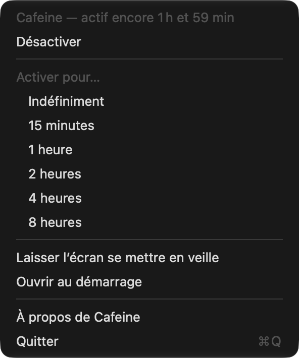
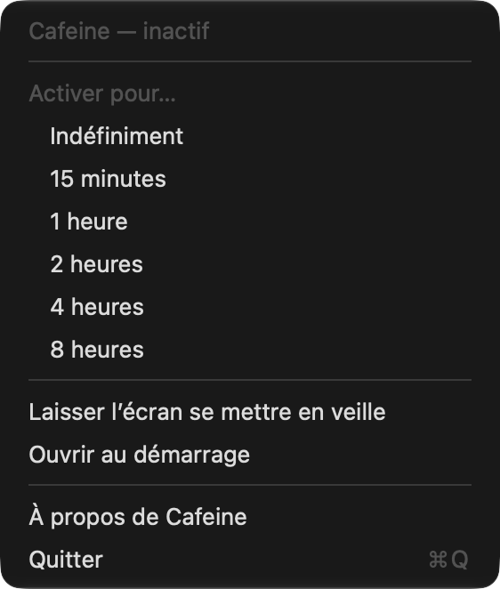

# Cafeine

[](https://github.com/gwenn-ha-dev/Cafeine/actions/workflows/ci.yml)
[](./LICENSE)


*🇬🇧 [English](./README.md) · 🇫🇷 Français*

Garde le Mac éveillé depuis la barre des menus : un clic sur la tasse, et le Mac ne se met plus en veille jusqu'au clic suivant ou jusqu'à la fin de la durée choisie.



## Fonctionnalités

- **Un clic** sur la tasse dans la barre des menus l'active ou la désactive. Une tasse pleine veut dire que le Mac reste éveillé ; le survol affiche le temps restant.
- **Une durée** depuis le menu : indéfiniment, 15 minutes, 1, 2, 4 ou 8 heures. À la fin, Cafeine laisse le Mac se remettre en veille.
- **Laisser l'écran se mettre en veille** garde le système éveillé mais laisse l'écran s'éteindre — pour un téléchargement ou un traitement long.
- **Ouvrir au démarrage**, depuis le menu.
- **Légère** : environ 12 Mo de mémoire, aucun sous-processus, aucune notification, aucune vérification de mise à jour, aucune fenêtre de réglages.
- Anglais, français, allemand, espagnol et italien, selon la langue du système.

| Inactive | À propos |
|---|---|
|  |  |

## Installation

Télécharge **`Cafeine-<version>.dmg`** depuis la [dernière release](https://github.com/gwenn-ha-dev/Cafeine/releases/latest), ouvre-le et glisse Cafeine sur Applications. L'app est signée avec un Developer ID et notarisée par Apple : elle s'ouvre d'un double clic. Nécessite macOS 13 ou plus récent, Apple silicon ou Intel.

Pour la construire depuis les sources :

```sh
git clone https://github.com/gwenn-ha-dev/Cafeine.git
cd Cafeine
make package      # build/Cafeine.app
```

## Utilisation

| Action | Effet |
|---|---|
| Clic sur la tasse | Active (sans limite de durée) / désactive |
| Clic droit ou ⌥-clic | Ouvre le menu |

Cafeine peut aussi démarrer déjà active, depuis un script ou un raccourci — la valeur est en secondes, `0` pour sans limite :

```sh
open -a Cafeine --args -activate 3600
```

Pour vérifier que le Mac est bien maintenu éveillé :

```sh
pmset -g assertions | grep Cafeine
```

## Fonctionnement

macOS permet à une app de tenir une *assertion d'énergie*, une demande pour que le système ou l'écran ne se mette pas en veille d'inactivité. Cafeine en tient une, nommée `Cafeine`, par `IOPMAssertionCreateWithName` — l'API qu'utilise `caffeinate` lui-même — et la libère quand on la désactive ou que la durée s'achève. Sans « Laisser l'écran se mettre en veille », l'assertion est `PreventUserIdleDisplaySleep` ; avec, `PreventUserIdleSystemSleep`.

Rien à relancer, rien à surveiller : l'assertion dure tant que Cafeine la tient, et le noyau la retire si l'app quitte ou plante, si bien que le Mac ne peut jamais rester bloqué éveillé.

## Compilation

| Commande | Ce qu'elle fait |
|---|---|
| `make build` | Build release, les avertissements sont des erreurs |
| `make test` | Lance la suite de tests |
| `make run` | Lance l'app |
| `make icon` | Régénère `Resources/AppIcon.icns` |
| `make package` | Construit `build/Cafeine.app` |
| `make sign` | La signe avec un Developer ID, la notarise et agrafe le ticket |
| `make dmg` | Met l'app notarisée dans un `.dmg` notarisé |
| `make shots` | Refait les captures de `docs/img/` |
| `make release-check` | Vérifie que `build/` est publiable |
| `make lint` | Vérifie la conformité à la charte du projet |
| `make help` | Liste toutes les cibles |

`./outils/package.sh install` construit l'app et remplace `/Applications/Cafeine.app`.

## Dépendances

Aucune — uniquement les frameworks d'Apple.

## Licence

MIT © 2026 gwenn-ha-dev — voir [LICENSE](./LICENSE).
