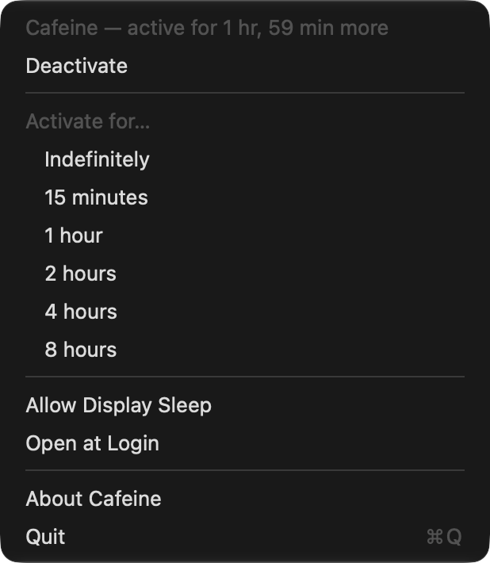
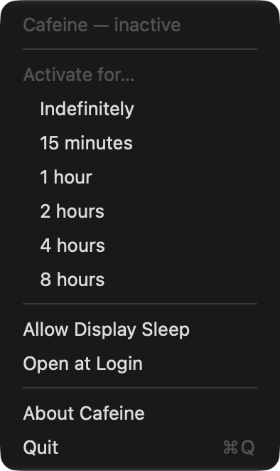
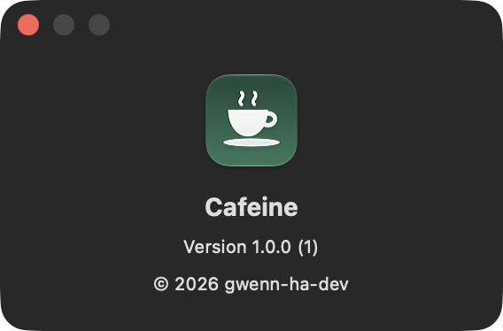

# Cafeine

[](https://github.com/gwenn-ha-dev/Cafeine/actions/workflows/ci.yml)
[](./LICENSE)


*🇬🇧 English · 🇫🇷 [Français](./README.fr.md)*

Keeps your Mac awake from the menu bar: one click on the cup, and the Mac stops going to sleep until you click again or the time you chose runs out.



## Features

- **One click** on the cup in the menu bar turns it on or off. A filled cup means the Mac stays awake; hovering it shows the time left.
- **A duration** from the menu: indefinitely, 15 minutes, 1, 2, 4 or 8 hours. When it runs out, Cafeine lets the Mac sleep again.
- **Allow Display Sleep** keeps the system awake but lets the screen turn off — for a download or a long job.
- **Open at Login**, from the menu.
- **Light**: about 12 MB of memory, no child process, no notifications, no update checker, no settings window.
- English, French, German, Spanish and Italian, following the system language.

| Inactive | About |
|---|---|
|  |  |

## Install

Download **`Cafeine-<version>.dmg`** from the [latest release](https://github.com/gwenn-ha-dev/Cafeine/releases/latest), open it and drag Cafeine onto Applications. The app is signed with a Developer ID and notarized by Apple: it opens with a double click. Requires macOS 13 or later, Apple silicon or Intel.

To build from source instead:

```sh
git clone https://github.com/gwenn-ha-dev/Cafeine.git
cd Cafeine
make package      # build/Cafeine.app
```

## Usage

| Action | Effect |
|---|---|
| Click the cup | Turn on (no time limit) / off |
| Right-click or ⌥-click | Open the menu |

Cafeine can also be started already active, for a script or a shortcut — the value is in seconds, `0` for no limit:

```sh
open -a Cafeine --args -activate 3600
```

To check that the Mac is being kept awake:

```sh
pmset -g assertions | grep Cafeine
```

## How it works

macOS lets an app hold a *power assertion*, a request that the system or the display not go idle-sleep. Cafeine holds one, named `Cafeine`, through `IOPMAssertionCreateWithName` — the API `caffeinate` itself uses — and releases it when you turn it off or the time runs out. Without Allow Display Sleep the assertion is `PreventUserIdleDisplaySleep`; with it, `PreventUserIdleSystemSleep`.

There is nothing to relaunch and nothing to poll: the assertion lasts as long as Cafeine holds it, and the kernel drops it if the app quits or crashes, so the Mac can never stay stuck awake.

## Build

| Command | What it does |
|---|---|
| `make build` | Release build, warnings are errors |
| `make test` | Run the test suite |
| `make run` | Launch the app |
| `make icon` | Regenerate `Resources/AppIcon.icns` |
| `make package` | Build `build/Cafeine.app` |
| `make sign` | Sign it with a Developer ID, notarize and staple it |
| `make dmg` | Pack the notarized app into a notarized `.dmg` |
| `make shots` | Retake the captures in `docs/img/` |
| `make release-check` | Check that `build/` is publishable |
| `make lint` | Check compliance with the project charter |
| `make help` | List every target |

`./outils/package.sh install` builds the app and replaces `/Applications/Cafeine.app`.

## Dependencies

None — Apple frameworks only.

## License

MIT © 2026 gwenn-ha-dev — see [LICENSE](./LICENSE).
